# Networkwalks Cybersecurity Lab Setup – Week 1 (WK1-PM1)

**Author:** Ahmed Walid Mohamed El-Ashram
**Program:** Networkwalks internship – Week 1, Project Module 1 (Lab Setup: VirtualBox and Kali Linux)

This repository documents my Lab 1 work: a small, isolated cybersecurity testing lab built on VirtualBox, with Kali Linux as the attacker machine and Windows 10 and Android as target machines, all on one NAT Network.

## Lab Overview

| VM | Role | OS | IP address |
|---|---|---|---|
| Kali Linux | Attacker | Kali Linux 2026.2 (amd64) | 10.0.0.2/24 |
| Windows 10 | Target | Windows 10 | 10.0.0.10/24 |
| Android | Target | Android-x86 9.0-r2 | 10.0.0.9/24 |

- **Hypervisor:** Oracle VirtualBox
- **Network:** custom NAT Network `NatNetwork`, `10.0.0.0/24`, DHCP enabled
- **Gateway:** `10.0.0.1`
- **Adapter:** Intel PRO/1000 MT Desktop (82540EM), Promiscuous Mode: Allow All

## Task Checklist

- [x] VirtualBox installed and used as the base
- [x] Kali Linux set up as the attacking machine
- [x] NAT Network `NatNetwork` created with subnet `10.0.0.0/24`
- [x] Kali IP set manually to `10.0.0.2/24`
- [x] Kali has full internet access
- [x] Shared folder with the host enabled
- [x] Windows 10 VM installed (`10.0.0.10`)
- [x] Android VM installed (`10.0.0.9`)
- [x] Connectivity tested from Kali to both VMs
- [x] Snapshot taken for every VM

## 0. VirtualBox Installation

Oracle VirtualBox Manager installed on the Windows 10 host.

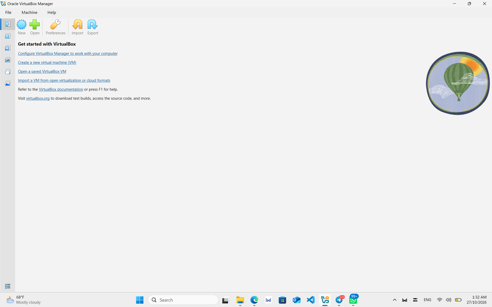

## 1. VirtualBox NAT Network

Created under **File → Tools → Network → NAT Networks**.

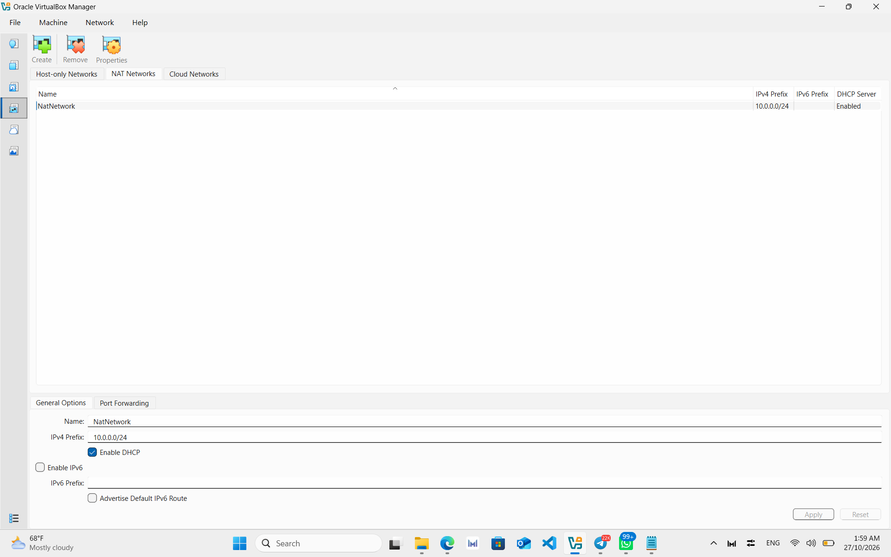

## 2. Kali Linux

### VM network settings
Adapter 1 is attached to the NAT Network `NatNetwork` with Promiscuous Mode set to Allow All.

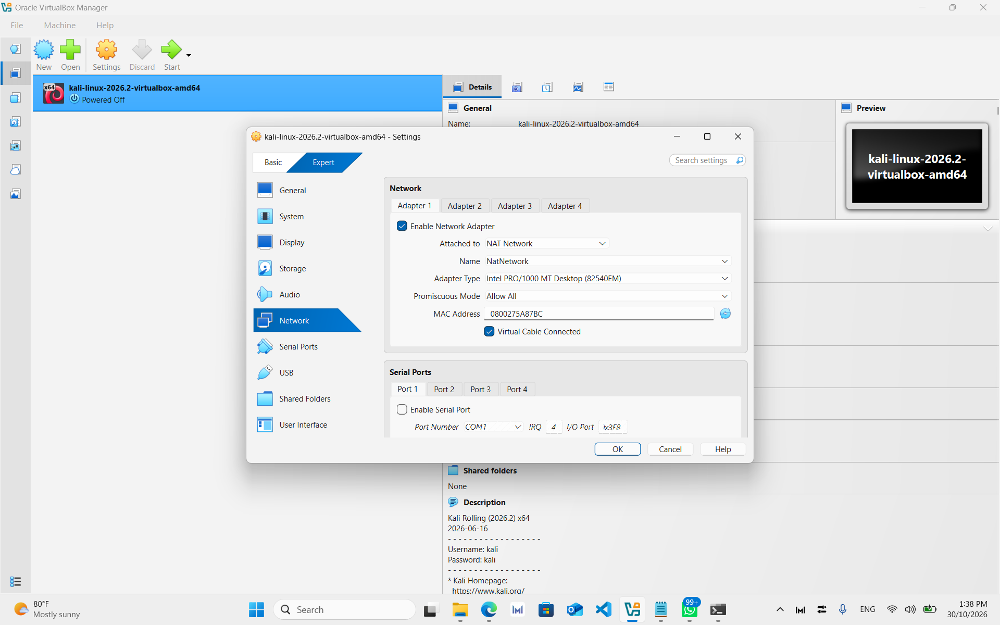

### Shared folder
The host folder `D:\networkwalks` is shared with the VM, with Auto Mount enabled and Full access.

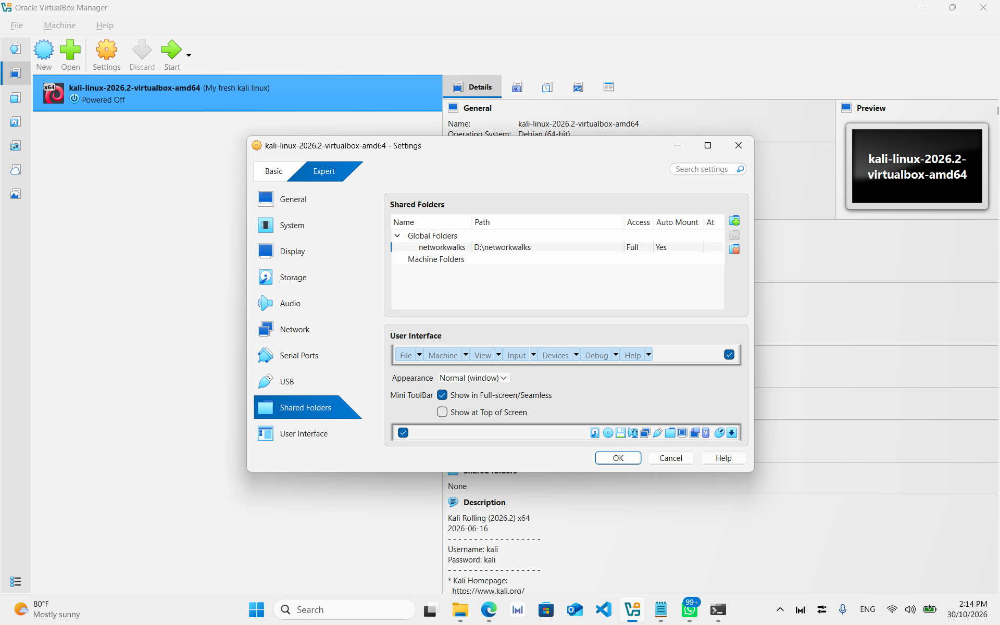

### Static IP configuration
Configured in **Edit Connections → Wired connection 1 → IPv4 Settings**: Manual, `10.0.0.2`, netmask `24`, gateway `10.0.0.1`, DNS `10.0.0.1`.

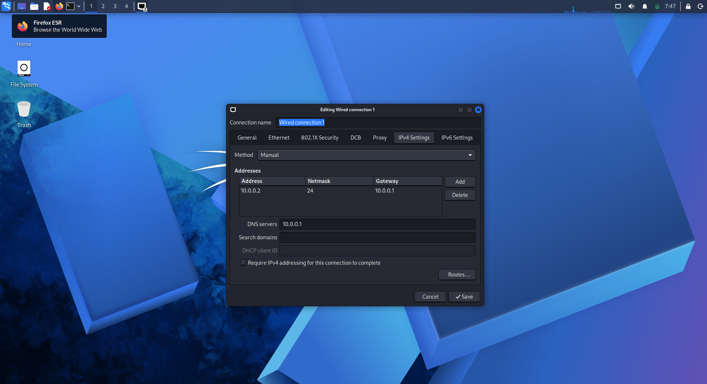

### Internet access
`ping 8.8.8.8` succeeds with 0% packet loss and the browser loads Google.

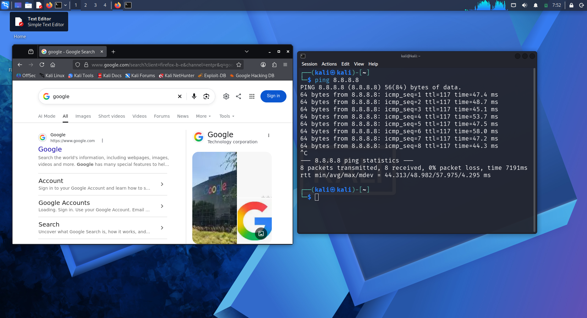

### Snapshot

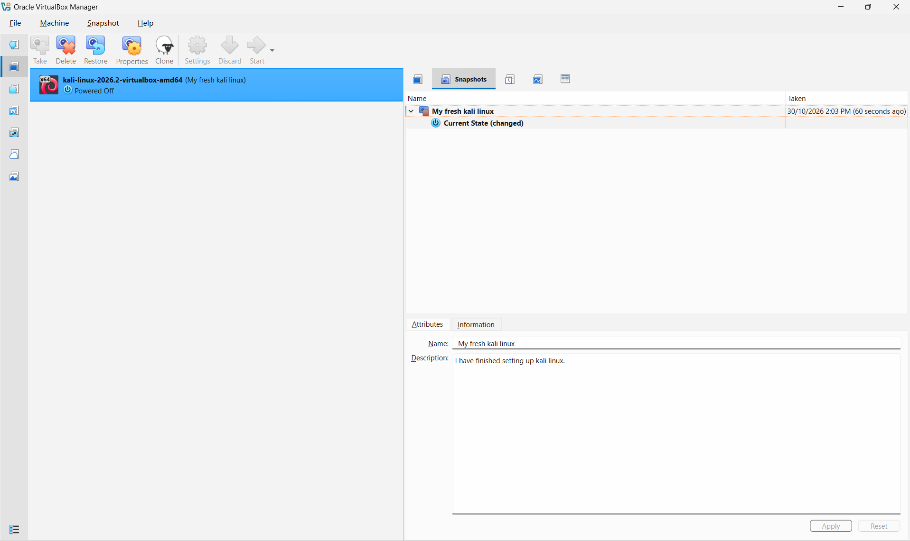

## 3. Windows 10

`ipconfig` confirms the static address `10.0.0.10`, mask `255.255.255.0`, gateway `10.0.0.1`.

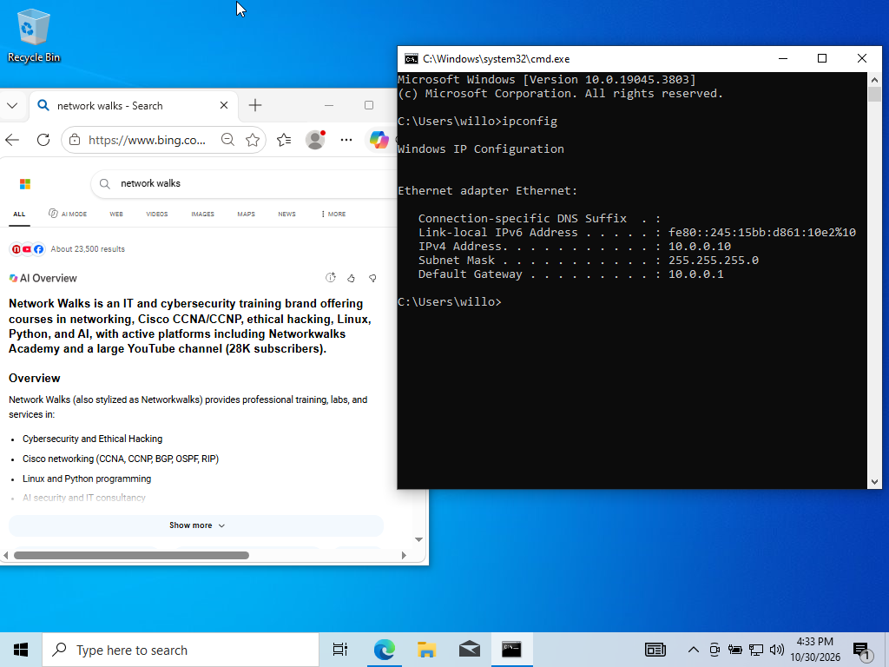

### Snapshot

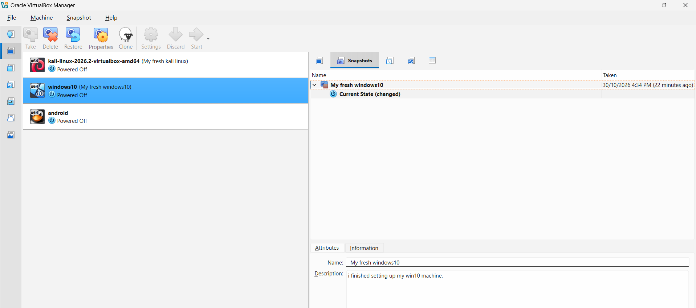

## 4. Android

Android-x86 9.0-r2 installed from ISO. Display uses VBoxVGA with 3D acceleration disabled. The static IP `10.0.0.9` is set on the VirtWifi network.

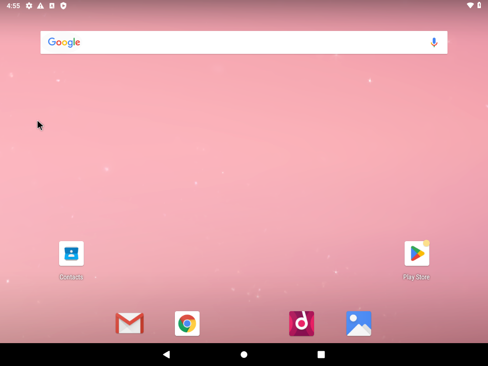
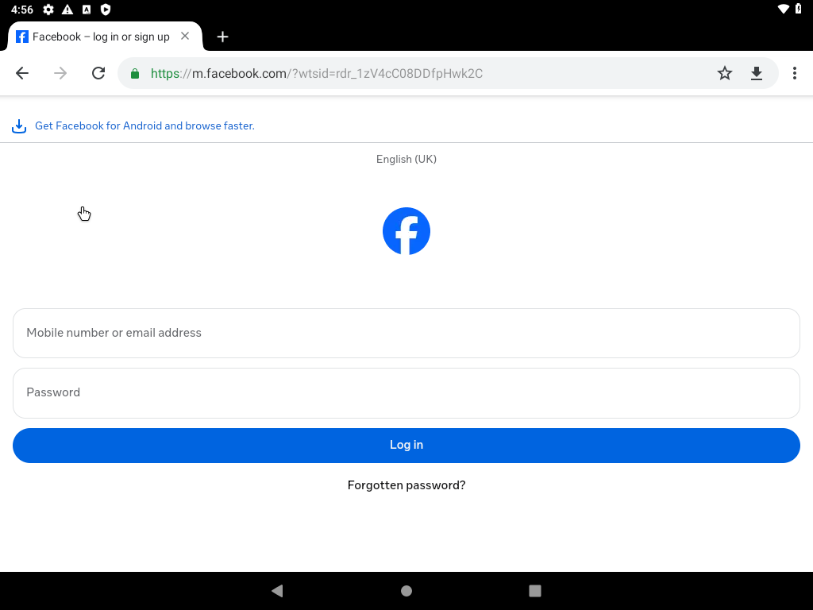

### Snapshot

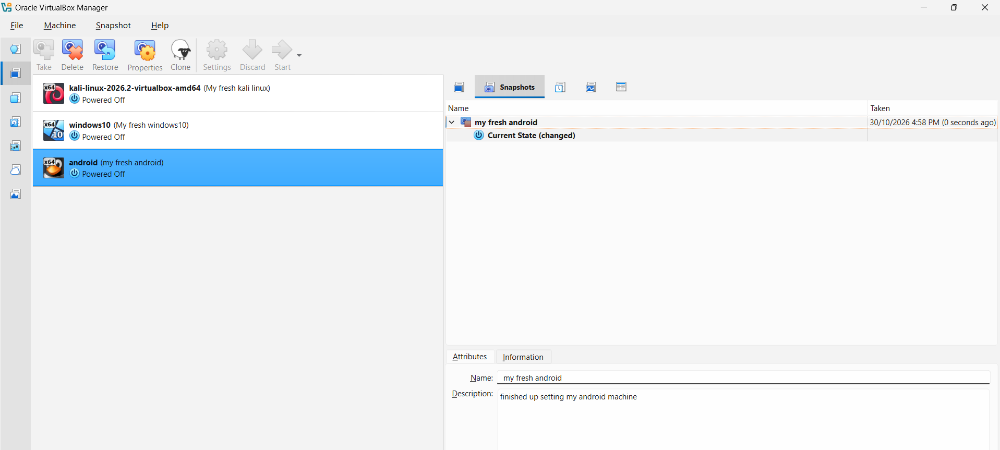

## 5. Connectivity Test

From Kali, both target machines reply to ping with 0% packet loss:

- `ping 10.0.0.10` (Windows 10)
- `ping 10.0.0.9` (Android)

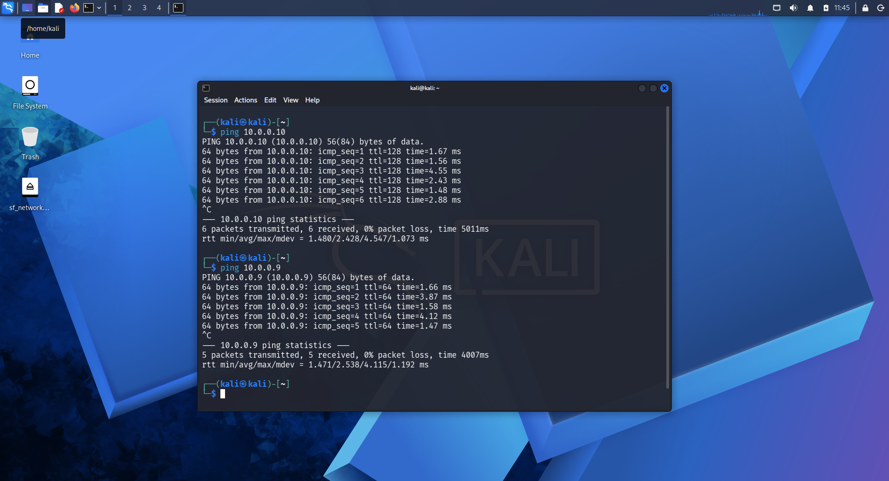

## Connectivity Issue

After setting the static IP, my Kali VM had no internet connection. I fixed it by running these commands and restarting the VM:

```bash
sudo nmcli connection modify "Wired connection 1" ipv4.dad-timeout 0
sudo nmcli connection down "Wired connection 1"
sudo nmcli connection up "Wired connection 1"
```

After that, Kali could reach the internet and both VMs.
